# October 10: Selected initial parts

I started by selecting the parts. Since there will be four identical motor driver circuits I will be trying kicad's sheets feature to make one driver circuit and copy it four times. I want this circuit to do two functions: to drive four brushless motors and to provide a stable 3.3v to the rest of the drone. Because this is the board connected to the battery it makes sense to also put the primary regulator on it too. For this I chose the LMR51450FN as has the specs I need with 5 amps out and is pretty cheap. I had to make a custom symbol for this because kicad didn't have one.

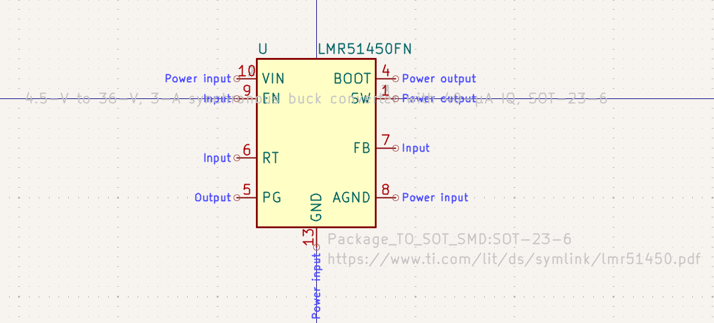

For the mcu for each driver I chose the STM32F318K8U6 as it was one of the cheapest ones I could find from ST's F3 or G4 lines which are made for signal processing. Even still each mcu is $5 and if I find a cheaper one that will do the job I'll use that instead. For the gate driver I chose the DRV8320S as I've worked with TI gate drivers before and this one was also fairly cheap. Kicad didn't have a footprint for it so I modified the foot print for the DRV8311S. 

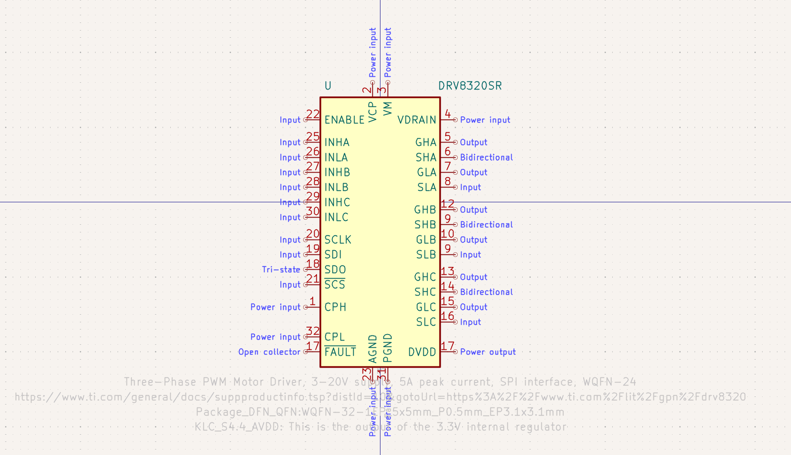

I then chose a mosfet for the actual gates. I found the DI030N10PT-AQ on digikey which was surprisingly cheap and was rated for 30A and 100V which is plenty. 

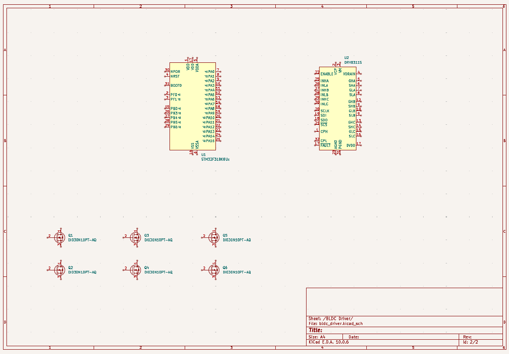

**Total time spent: 3 hours**

# October 13: Wired regulator schematic

I decided to start wiring the regulator first. TI has a really nice tool that generates a schematic which I used.

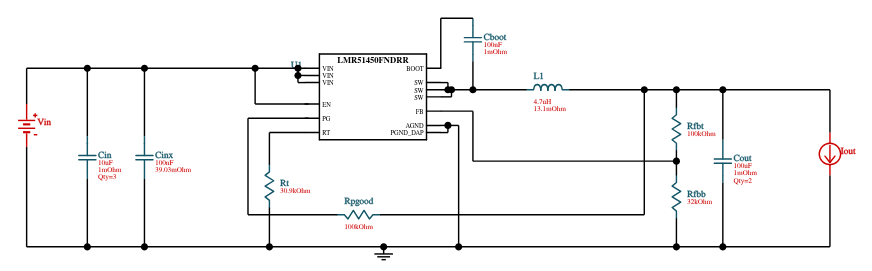

I then copied this over to kicad.

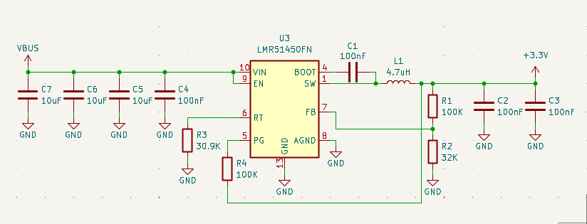

**Total time spent: 1 hours**

# October 13: Wired MCU

Next I went to routing the mcu for the driver. After looking over the datasheet the mcu needs a separate 1.8v digital supply so I added a simple ldo regulator. The analog voltage will still be 3.3v because the mcu supports that and because I will be measuring high voltage which will be steped down and the lower the max voltage the less accurate it is. I opened up STM32CubeMX to get the pinout and tried a few times to get everything I need. It was a bit tricky because the mcu doesn't have many pins and I need a lot of different functions. After a few tries I managed to get everything I wanted. At first I wasn't sure if I should add SPI for the gate driver because I thought I wouldn't have enough pins and I might need a level shifter. After checking the gate driver datasheet it does support 1.8v digital supply so I chose to add in the SPI.

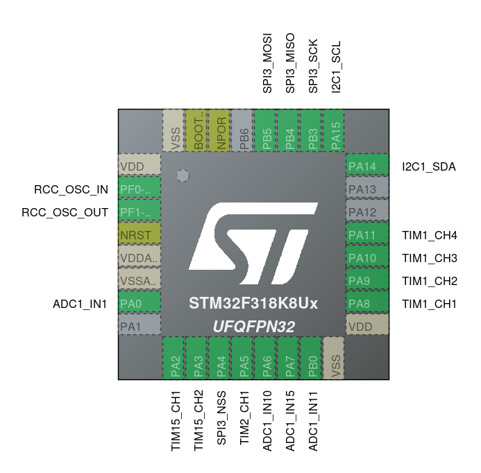

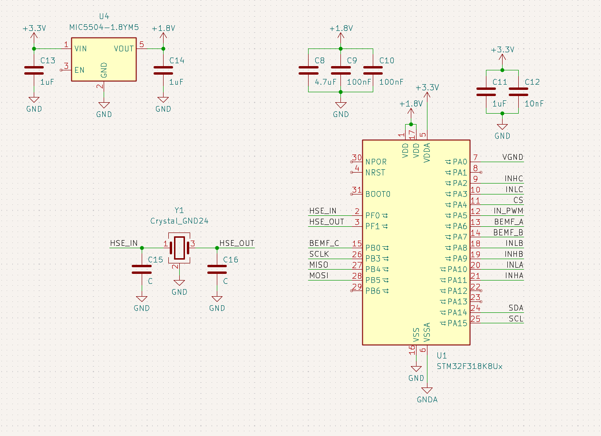

**Total time spent: 2 hours**

# October 14: Wired gate driver circuit

Right after the last journal I realized I had no way of programming the mcu. The datasheet said it could be flashed through SPI1 which I was using but through different pins. I decided to add test points for a uart interface so that way I could put it into boot mode and flash it that way. I also added test points for the reset pins and added external labels for the sheet.

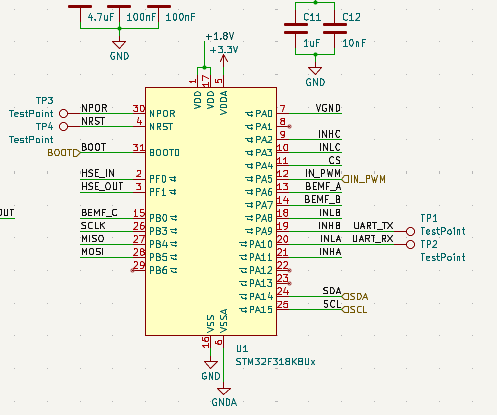

I then went on to wire up the gate driver. I followed the datasheet and double checked that everything will work with 1.8v instead of the normal 3.3v. From what I can find it will still work fine but I think I'll reach out to TI to be absolutly sure.

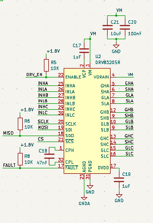

Next I added a TVS diode for overvoltage protection. The gate driver is rated for 60v and the mosfets for 100v. I chose a maximum voltage of 40v to give me plenty of headway. I then added a p channel mosfet for reverse current protection because the motor can drive the current backwards.

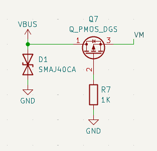

Then I went to the actual inverter circuit. For a previous board I added a bunch of fancy r-c snubbers and shunt resistors but I decided to keep it simple here because I'm not going for peak performance. The gate driver doesn't have current measurement anyway so I routed it up with little extra components. I did add voltage dividors to measure each line voltage safely.

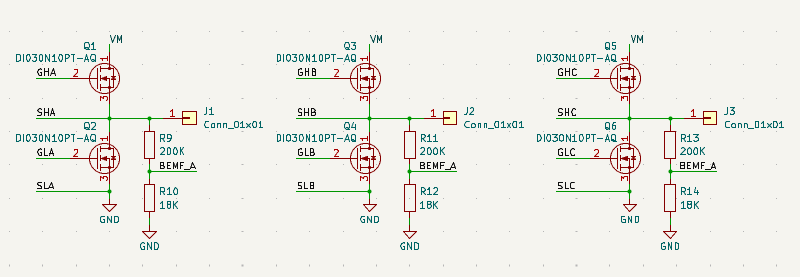

To read the true voltage of each motor phase it needs to be compared to the motor's ground. I can recreate that circuit with a set of resistors to create a virtual ground.

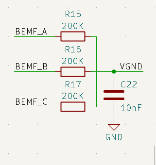

**Total time spent: 3 hours**

# October 15: Added overvoltage protection and bulk capacitance

The circuit needs a lot of capacitance to smooth out the noisy switching of the gates and the feedback of the motor. I found online that a good rule of thumb is about 20uF per 1A which puts me at roughly 600uF for 30A. It is also good to have some electrolytic capacitors with high capacitance for low frequency ripples and ceramic capacitors with low capacitance for high frequency ripples. For my design I have two 270uF electrolytic capacitors and six 10uF ceramic capacitors for a total of 600uF.

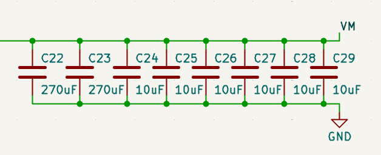

I also added one 1000uF capacitor that will be soldered on externaly on the battery leads for extra capacitance for the entire board. There is also another TVS diode to prevent overvoltage.

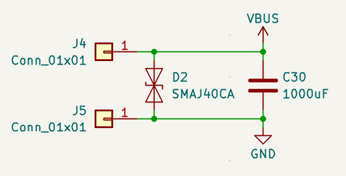

I decided to add extra overvoltage protection on the analog lines with some barrier diodes.

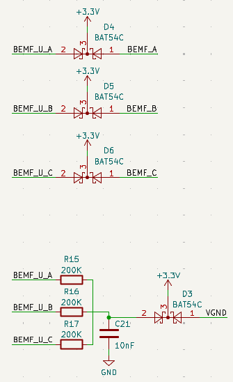

**Total time spent: 2 hours**

# October 19: Selected footprints and made regulator layout

### Selecting footprints

To start the pcb layout I selected footprints for all the components. I had to do a little digging to find the right footprint for the mosfets but I found the right one eventually. The rest was pretty straightforward.

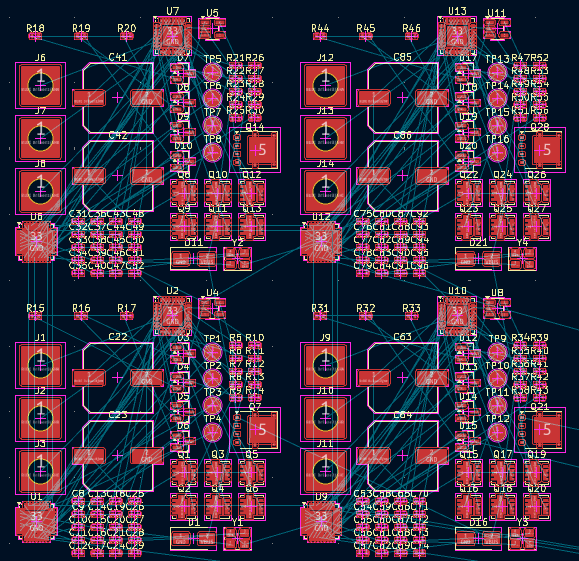

### Regulator layout

I started making the pdb layout with the regulator. I noticed that I had the wrong footprint for the ic so I went and fixed that and finished it up. 

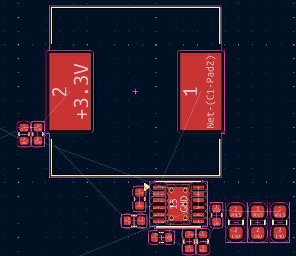

**Total time spent: 2 hours**

