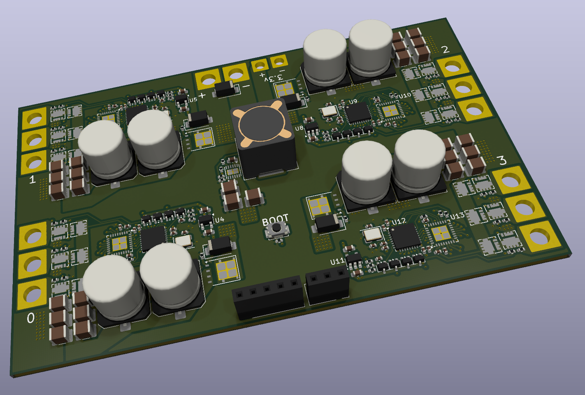
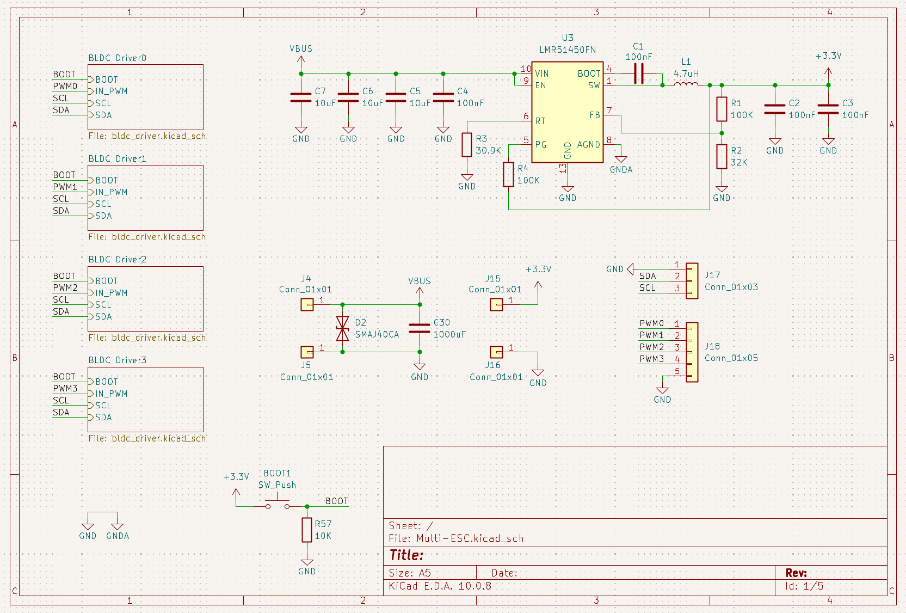
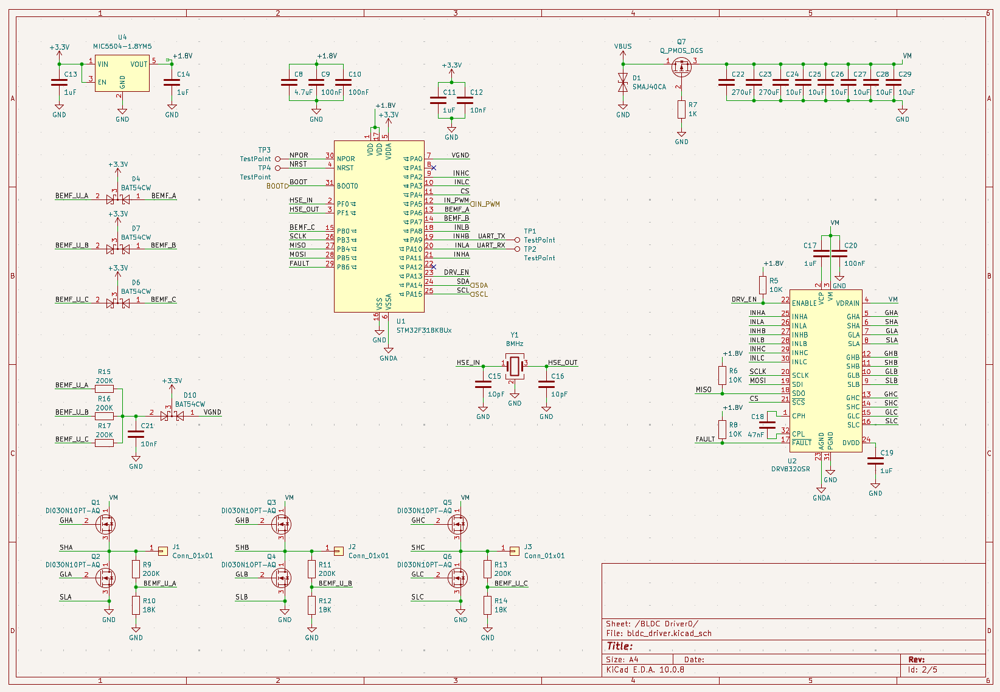
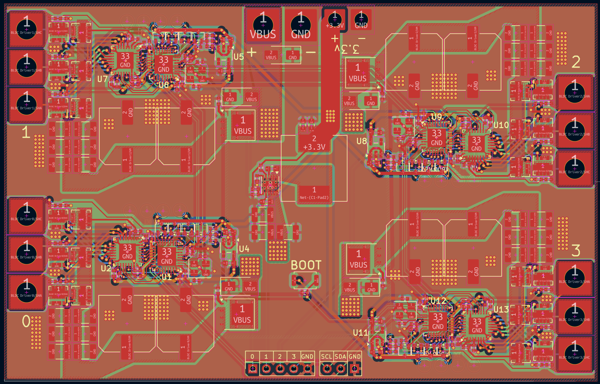

# Multi-ESC

A custom drone ESC to control four brushless motors at once. It also provides 3.3v output at 5A. The ESC should be able to handle 120A (30A on each driver) with at least 25v but this is still untested. To flash the MCUs, press the boot button put them into boot mode, then flash them over UART with the pads on the back of the board. This is one of my projects to try to make a drone from scratch.

## Root Schematic

## Driver Schematic

## PCB

## BOM
The BOM is located in production/BOM.csv and production/DigiKeyBOM.csv for ordering the parts from DikiKey. Alternatively the DigiKey BOM can be found [here](https://www.digikey.com/en/mylists/list/6IF22QFQMQ)

